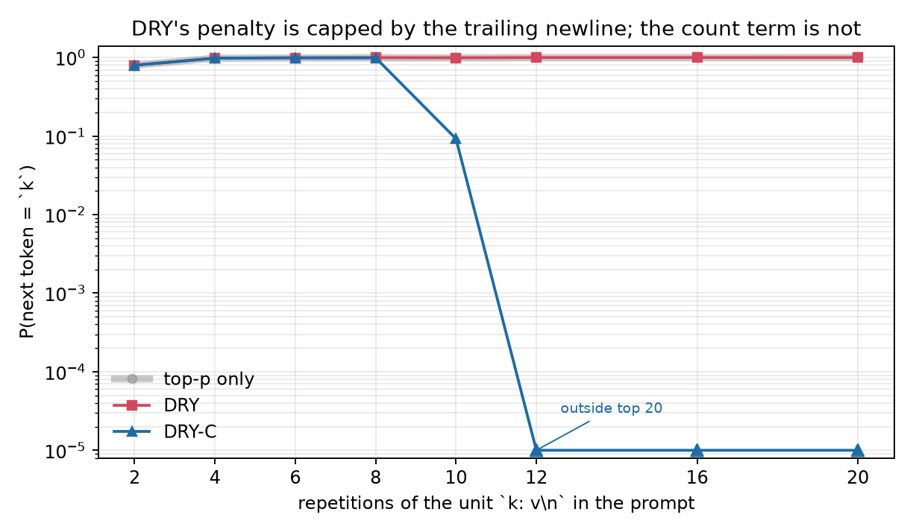

# unloop

[](https://github.com/DrMkdaddy/unloop/actions/workflows/test.yml)

**A count term for llama.cpp that breaks the repetition loops DRY can't.**

DRY penalizes a token by how long the repetition is. That length is capped by
sequence breakers, so a loop that contains a break token (`\n`, `:`, `"`, `*`)
can stay locked forever: the penalty stops growing exactly where the model
needs it to keep growing.

[arXiv:2610.24715](https://arxiv.org/abs/2610.24715) proposes a second signal:
count how many times a token followed an earlier occurrence of the current
suffix, and let that count grow exponentially. Sequence breakers do not cap a
count. This repo is a reference implementation of that term, a patch that puts
it inside llama.cpp's DRY sampler, and measurements on a real model.

## Result

<!-- RESULTS:START -->
### The blind spot, measured on a real model

Prompt: `k: v\n` repeated `R` times, ending on a unit boundary. The next token
should be `k`. The unit contains two DRY sequence breakers (`:` and `\n`), so
the last token is a breaker, `rep_limit` is 0, and **DRY's length term does not
run at all**. The count term has no such cap.

`P(k)` after the sampler, Qwen3-4B-Instruct-2507 Q4_K_M, one forward pass,
temperature 1, top-k/top-p off:

| R | top-p | DRY | DRY-C |
|---:|---:|---:|---:|
| 2 | 0.796 | 0.796 | 0.796 |
| 6 | 0.990 | 0.990 | 0.990 |
| 8 | 0.996 | 0.996 | 0.991 |
| 10 | 0.993 | 0.993 | **0.092** |
| 12 | 0.998 | 0.998 | outside top 20 |
| 16 | 0.998 | 0.998 | outside top 20 |
| 20 | 0.999 | 0.999 | outside top 20 |

DRY does not move across the sweep. DRY-C crosses below the best alternative
between 8 and 10 repetitions and has removed the token by 12. Same weights,
same logits, one extra term.



### The lock, simulated

A two-token state machine from the paper's `(n, l)` analysis, with
`lambda = 0.8`, `b = 1.75`, `a = 2`, `c0 = 2`, `b_c = 3`, a breaker-free run
`g = 6`, and a loop token whose raw margin is `delta = 4.815`. 300 trials, 200
steps max:

| sampler | still locked at 200 steps | median escape |
|---|---:|---:|
| top-p alone | 100% | never |
| DRY (length term only) | 100% | never |
| count term only | 0% | step 4 |
| DRY-C (max of both) | 0% | step 4 |

DRY's cap is `0.8 * 1.75 ** (6 - 1 - 2) = 4.29 < 4.815`, so it can never
unlock. The count term reaches 4.815 at the fourth recurrence. This is the
paper's Proposition 5 and Corollary 4 in one table.

### Spontaneous generation

`bench/llama_bench.py` also runs a 16-prompt structured suite (lists, JSON,
CSV, markdown tables, logs, quiz, code) through `llama-server`. At temperature
1.0 the 4B model did not fall into a token loop on any of the 14
non-repetition prompts under any sampler, so that suite does not separate the
configs. It does show DRY's known cost: asked to repeat one sentence 25 times,
top-p repeats it verbatim 25 times, count-only stops at 9, and DRY and DRY-C
mutate it into near-copies (`lazy狗`, `lazydog`, ...) instead of repeating it.

Decode throughput on the same suite: 159 tok/s (top-p), 137 (DRY), 126
(DRY-C), 153 (count-only). Count-only is cheaper than DRY because it skips the
Z-algorithm; DRY-C pays for both terms. The raw texts are in
`results/llama_dryc.json`.
<!-- RESULTS:END -->

## What is implemented

| Path | What it is |
|---|---|
| `dryc/sampler.py` | DRY length term and DRY-C count term, dependency-free reference |
| `dryc/sim.py` | the `(n, l)` lock state machine used by the paper's analysis |
| `patches/llama.cpp-dry-c.patch` | +237/−8 across 7 files, against `7d7f028` |
| `bench/teacher_forced.cpp` | one-pass measurement; feeds the prompt tokens to the sampler |
| `bench/teacher_forced_run.py` | repetition sweep + `results/teacher_forced.json` |
| `bench/llama_bench.py` | spontaneous A/B through `llama-server`, raw JSON + texts |
| `bench/sim_bench.py` | reproducible lock/escape table |
| `tests/test_sampler.py` | 12 unit tests, including the four `test-sampling.cpp` cases |

The count term is:

```
c(v)     = number of earlier positions in the window that are preceded by the
           current a'-token suffix and followed by v
d_cnt(v) = lambda * b_c ** (c(v) - c0)    if c(v) >= c0, else 0
penalty  = max(d_DRY(v), d_cnt(v))
```

with the paper's defaults `W = 4096`, `a' = 24`, `c0 = 2`, `b_c = 3`, and
`lambda` shared with DRY. It applies to breaker tokens as well, which is the
whole point.

## Tests

```bash
$ python3 -m unittest discover -s tests -v
...
Ran 12 tests ... OK

$ ./build/bin/test-sampling
...
OK
```

The C++ cases assert the same probabilities as the Python tests, so the patch
and the reference cannot drift silently. The interesting one is
`test_applies_to_breaker_tokens`: a single-token breaker is penalized by the
count term even though the length term skips it.

## Reproduce

```bash
# reference + simulation
./scripts/reproduce.sh

# real model: build the teacher-forced driver against the patched tree
g++ -O2 -std=c++17 bench/teacher_forced.cpp \
    -I/path/to/llama.cpp/include -I/path/to/llama.cpp/ggml/include \
    -L/path/to/llama.cpp/build/bin -lllama \
    -Wl,-rpath,/path/to/llama.cpp/build/bin -o bin-teacher-forced

python3 bench/teacher_forced_run.py --binary ./bin-teacher-forced \
    --model /path/to/Qwen3-4B-Instruct-2507-Q4_K_M.gguf
python3 bench/plot_teacher_forced.py

# optional: spontaneous generation through llama-server
LLAMA_SERVER=/path/to/llama-server \
MODEL=/path/to/Qwen3-4B-Instruct-2507-Q4_K_M.gguf \
./scripts/reproduce.sh
```

The teacher-forced driver is deliberately not `llama-server`: the server only
accepts **generated** tokens into the sampler, while the paper's teacher-forced
setup feeds the repeated context itself. The driver does the latter (one decode,
then `llama_sampler_accept` over the prompt tokens), so the count sees the loop
before a single token is sampled.

### OpenCode plugin

The repo also ships a plugin that uses the same detector inside
[OpenCode](https://opencode.ai): [`plugin/`](plugin/README.md). It adds an
`unloop_scan` tool and a `/unloop` command, and can leave a notice when a turn
ends in a loop. The plugin is post-hoc; the patch is preventive.

```jsonc
{
  "plugins": [
    { "package": "/absolute/path/to/unloop/plugin", "options": { "guard": true } },
  ],
}
```

The committed run used:

| | |
|---|---|
| GPU | AMD Radeon RX 9070 XT (RADV GFX1201), Vulkan |
| CPU | Intel Core i7-10700K |
| Model | Qwen3-4B-Instruct-2507 Q4_K_M |
| Teacher-forced | one decode, temperature 1, top-k/top-p off |
| Spontaneous | temp 1.0, top-p 0.95, top-k 40, seed 42, 512 tokens |
| llama.cpp | `7d7f028` + `patches/llama.cpp-dry-c.patch` |

## Scope

- The simulation is a model of the paper's state machine, not a measurement of
  a language model. It shows the mechanism: a capped penalty stays capped, an
  uncapped count eventually wins.
- The real-model numbers are one model, one seed, one prompt suite. They are a
  sanity check on the patch, not a benchmark of the paper's 1,800-generation
  study.
- `count-only` (`--dry-count --dry-allowed-length 100000`) is the paper's
  "count term without the length term". `dry-c` keeps both and combines them
  with `max()`.

## Citation

```bibtex
@article{chen2026loops,
  title   = {When Do Repetition Loops Lock? Truncation Sampling, Bounded
             Penalties, and a Blind Spot in DRY},
  author  = {Chen, Yichuan and Wang, Xin},
  journal = {arXiv preprint arXiv:2610.24715},
  year    = {2026}
}
```
